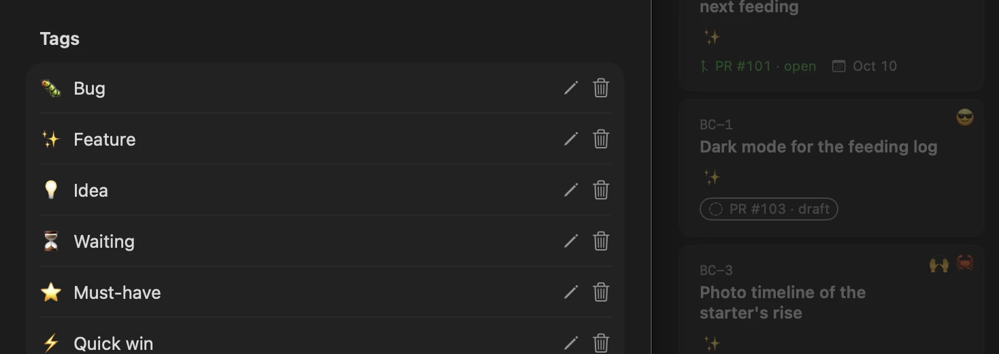

# Jannoo features

The board is free forever, and Pro adds GitHub sync and lets agents change cards.

## Your pull requests, on the card.

*Pro*

- **Issues as cards.** Move a card to Done and the issue closes.
- **Pull requests on the card.** Draft, open, merged or closed, on the card.
- **Every repo you give Jannoo.** Sign in, pick the repo, name the board: done.

Comments and labels sync too. Jannoo never sees your repository or board.

## Make the board yours.

*Free*

- **Emoji reactions.** React to any card with any emoji you like.
- **Custom emoji tags.** Name a tag, give it a colour and, if you like, an emoji. Each board keeps its own.
- **Checklists.** Steps on the card, ticked off one by one. The card’s face shows the count.
- **Quick open.** Press ⌘K and type a number or a few letters. Jump to the card on this board, or any of yours.

Epics, card links, attachments and dark mode are free too.

## A board is a folder you can read.

*Free*

- Every board is a folder of Markdown files on your Mac. It stays yours if you uninstall Jannoo.
- No account needed. Work offline.
- Obsidian opens the same cards. Obsidian is the notebook; Jannoo is the board.

## Your agent works the board.

*Free to read. Pro to change.*

Let your agent keep the board up to date.

- Claude Code, Codex and Cursor can work the board.
- Reading is free. Pro lets agents add, edit and move cards.
- You allow changes first; each change is previewed before saving and logged on your Mac.

Install the app first, then connect your agent: [jannoo.app/agents](https://jannoo.app/agents).

## Your board, in your pocket.

Jannoo for iPhone is free and coming to the App Store. With Pro, open your Mac’s boards through iCloud Drive, even when your Mac is off.

## Also included with Pro.

Boards in tabs, list and outline views, and custom card fields.

## Good to know.

- Mac only today; requires macOS 26 or later.
- There is no Trello importer; start a board fresh.
- When your trial or Pro ends, Pro features stop. Your board keeps working. Nothing is deleted.
- For a refund, ask within 14 days of any payment.
