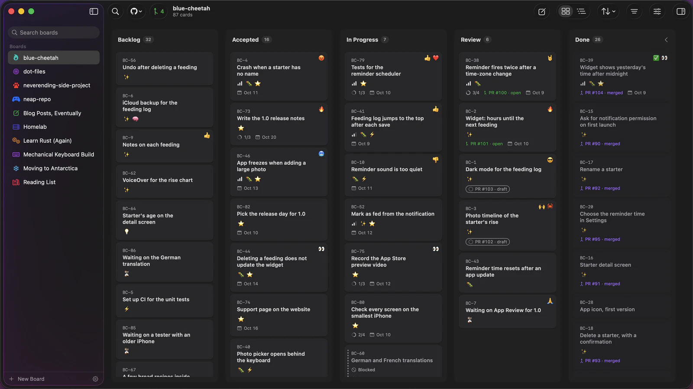

# Jannoo

**Kanban for your agents.**

Jannoo is a native Mac kanban app. Your board is a folder of Markdown files you own, where GitHub issues become cards and your agent can work.

[Download for Mac](https://jannoo.app/download) · macOS 26 or later · [jannoo.app](https://jannoo.app)

- **GitHub issues as cards.** With Pro, move a card to Done and its issue closes.
- **Emoji reactions and tags.** React with any emoji and make tags your own with colour and emoji.
- **Agents work the board.** Claude Code, Codex and Cursor read for free and add, edit or move cards with Pro.
- **Yours, with no account.** Keep boards as folders of Markdown files on your Mac and work offline.
- **Free forever.** Make as many boards as you like.

## The local board is free forever.

Pro is a subscription at $10 a month or $80 a year. Every [download](https://jannoo.app/download) includes 7 days of Pro, with no account and no payment card.

## In this repository.

Find features, release history and bug reports here. This repository holds no code.

| | |
|---|---|
| [FEATURES.md](FEATURES.md) | What Jannoo does |
| [CHANGELOG.md](CHANGELOG.md) | What changed in each release |
| [Issues](../../issues) | Bug reports |

## Report a bug.

[Report a bug](../../issues/new/choose) if something goes wrong. Include your Jannoo version and build, macOS version and the steps that led to the problem.

Issues are public, so leave out license keys, GitHub tokens and private board contents. Send anything private to [support@jannoo.app](mailto:support@jannoo.app).

## Links.

- For agents: [jannoo.app/agents](https://jannoo.app/agents)
- The plugin for Claude Code and Codex: [jannooapp/jannoo-mcp](https://github.com/jannooapp/jannoo-mcp)
- Privacy: [jannoo.app/privacy](https://jannoo.app/privacy)

Jannoo is made by Cadence Hill LLC.
